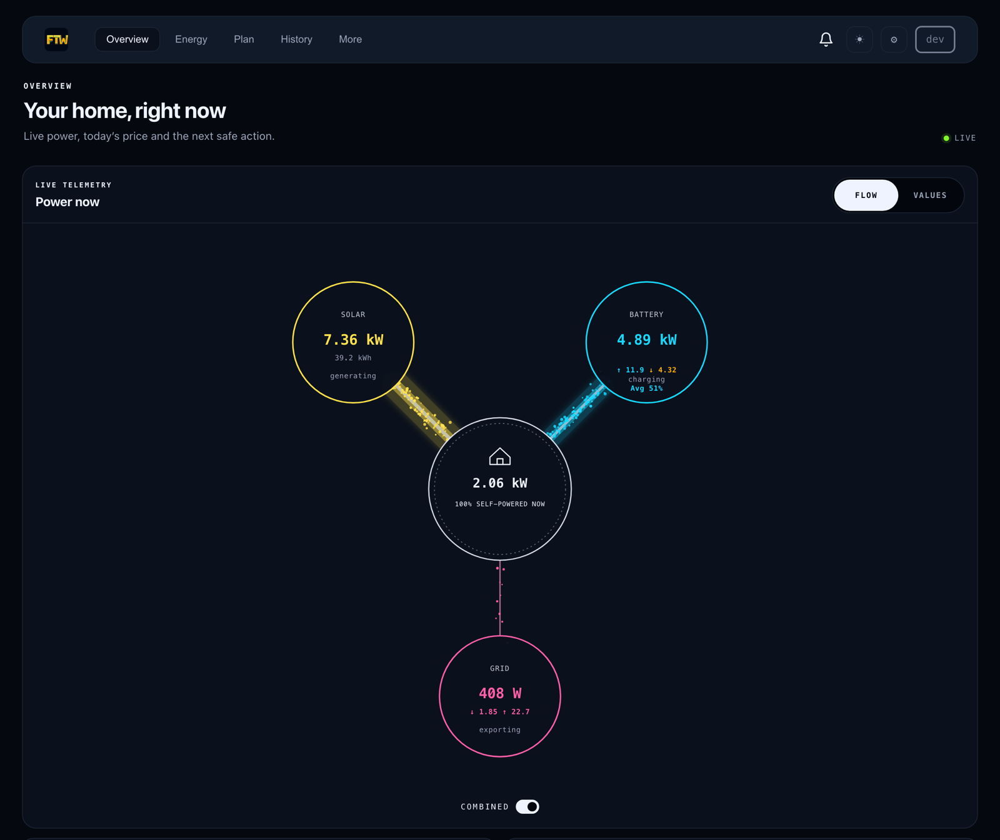

# FTW


> Your home's energy, planned to cost less.

FTW runs on a small computer in your home. It plans your battery, car charging
and solar around electricity prices and the weather, then runs them. Control
stays on your home network, so your home keeps running when the internet is
down.



*The dashboard every install gets, here with simulated devices.*

[Website](https://ftw.energy) ·
[Try the demo](https://app.ftw.energy) ·
[Check your equipment](https://srcfl.github.io/device-drivers/) ·
[Discord](https://discord.gg/UK2ygPBu8N)

## Get started

FTW is in public beta. Pick what you already have.

### Home Assistant

FTW runs as an app inside Home Assistant OS, for example on a Home Assistant
Green.

[](https://my.home-assistant.io/redirect/supervisor_add_addon_repository/?repository_url=https%3A%2F%2Fgithub.com%2Fsrcfl%2Fhome-assistant-addons)

Add the repository, install **FTW (0.x beta)** from the app store, start it
and choose **Open web UI**.
[Step by step](docs/home-assistant-app.md) ·
[svenska](docs/setup-guide/home-assistant-sv.md)

The app is a beta in its first pilot. The longer-tested path is FTW on a
separate Linux computer, connected to Home Assistant over
[MQTT](docs/ha-integration.md).

### Raspberry Pi or another Linux computer

1. New to the Raspberry Pi? [Prepare it, with pictures](docs/setup-guide/en.md)
   ([svenska](docs/setup-guide/sv.md), [Deutsch](docs/setup-guide/de.md),
   [français](docs/setup-guide/fr.md), [español](docs/setup-guide/es.md)).
2. [Install FTW](docs/install.md#raspberry-pi-or-linux) with one pasted block
   ([svenska](docs/setup-guide/install-sv.md#raspberry-pi-eller-linux)).
3. Open `http://<host>:8080/setup` and add your devices.

### After setup

- **Phone:** get the [iPhone beta](https://testflight.apple.com/join/E4Japad7)
  and [pair it with your box](docs/pairing.md), or try the
  [webapp](https://app.ftw.energy).
- **AI assistant:** [connect Claude, ChatGPT or another assistant](https://ftw.energy/#ai)
  and ask why the battery is charging.
- **Home Assistant entities:** FTW publishes its values over
  [MQTT](docs/ha-integration.md).

**Already running FTW 2.x, 3.x or the old Raspberry Pi image?** Those lines
get no more updates. Follow the
[switch guide](docs/native-beta.md#coming-from-an-older-ftw) first, and do not
run the installer on the old card or host.

## Product direction

FTW should make mixed equipment simple to live with: useful first-day
planning, reliable daily charging, fast and honest live feedback, and
structured access for agents. The default experience should need few choices
while keeping expert controls and Lua drivers available.

[VISION.md](VISION.md) is the product direction set by Fredrik.
[docs/roadmap.md](docs/roadmap.md) lists the outcomes and proof needed. These
include goals that have not shipped; the capability list below is separate.

Sourceful Energy maintains FTW Community under AGPL-3.0-only with the
Energyplan combination permission. Contributions are welcome, preferably
starting with [issues](https://github.com/srcfl/ftw/issues). Share a short
Markdown proposal or a focused fix with relevant test evidence.
See [CONTRIBUTING.md](CONTRIBUTING.md). Community help is best effort;
[SUPPORT.md](SUPPORT.md) describes separate commercial services.

Join the [FTW Discord](https://discord.gg/UK2ygPBu8N) for questions and community discussions.

See [project statistics](https://stats.ftw.energy/) for public development
activity and anonymous usage totals.

## Architecture

FTW is a local-first home energy management system (EMS). It coordinates
solar, batteries, grid power, EV charging and thermal assets on a Raspberry Pi
or Linux host. The safety-critical runtime is one Go binary,
hardware integrations are sandboxed Lua drivers, and a compiled Energyplan
worker handles long-horizon planning.

The control path stays on the local network. Cloud price, weather and device
integrations degrade independently; they are not required for safe local
operation.

FTW has three explicit modules:

- **Core** owns configuration, telemetry, state, safety, dispatch, API and UI.
- **Drivers** translate vendor protocols and power signs in isolated Lua VMs.
- **Optimizer** proposes plans over a versioned contract; core validates every
  result and keeps a Go fallback.

Drivers and the optimizer can evolve without moving safety authority out of
Core. A new module needs a concrete reason and must reduce the complexity of
the whole product. See [docs/architecture.md](docs/architecture.md).

## Capabilities

- self-consumption, peak shaving and explicit grid targets;
- multi-battery allocation with fuse, SoC, slew and stale-data protection;
- price-, weather-, PV- and load-aware planning;
- EV charging, V2X and thermal planning;
- local web UI, with history and configuration in SQLite;
- Home Assistant MQTT discovery;
- hot-reloadable, independently released Lua drivers;
- a built-in OCPP 1.6J + 2.0.1 server, so OCPP chargers connect with no driver.

The local catalog is generated from `DRIVER` metadata. The public
[`srcfl/device-drivers`](https://github.com/srcfl/device-drivers) repo is the
editable source and FTW's default signed driver channel.

**This repository holds no driver source.** `drivers/*.lua` is gitignored and
fetched with `make drivers` at the commit pinned in
[`drivers/BUNDLED_SOURCE.json`](drivers/BUNDLED_SOURCE.json). Fix a driver
upstream and move the pin; see
[The bundled pin](docs/device-repository.md#the-bundled-pin).

## Local development

Requirements are Go and Node.js. Python 3 verifies release artifacts during
development; no Python interpreter or service runs the planner.

```bash
git clone https://github.com/srcfl/ftw.git
cd ftw
make dev
```

Useful checks:

```bash
make test      # Go tests
npm test       # web
make verify    # fast test, compose, vet and build checks
make e2e       # simulator-backed full stack
make ci        # e2e, builds and browser smoke
```

See [docs/development.md](docs/development.md) for the small set of development
workflows.

## Configuration

[`config.example.yaml`](config.example.yaml) and the validation types in
[`go/internal/config`](go/internal/config) are the configuration reference. Copy the example for a native development setup:

```bash
cp config.local.example.yaml config.local.yaml
```

Power values above a driver use one convention: positive means into the site,
negative means out. Drivers alone translate vendor conventions. Read
[docs/site-convention.md](docs/site-convention.md) before editing power math or
writing a driver.

## Drivers

Drivers are plain Lua files and need no compilation. A driver declares its
catalog metadata, lifecycle and required capabilities in one file. The Go host
provides capability-scoped Modbus, MQTT, serial, HTTP, WebSocket and TCP access.

Which devices are covered, and on what evidence, is published as a searchable
catalog: **[Device driver catalog](https://srcfl.github.io/device-drivers/)**.
It is generated from `srcfl/device-drivers` on every push to that repository's
`main`, so the versions, tested models and per-target status it shows are the
ones FTW installs. Listing is not an install claim: the page states which
drivers have been confirmed against physical hardware and which have not.

Start with [docs/writing-a-driver.md](docs/writing-a-driver.md). Send shared
driver changes to `srcfl/device-drivers`. That repo publishes one signed,
content-addressed asset per driver and version. FTW downloads only the chosen
driver, which can update or roll back without a new FTW core release. Device
Support may consume the same public source later for other products or a higher
support level.

EV chargers that speak OCPP are the exception: they need no driver. FTW runs an
OCPP Central System (1.6J and 2.0.1), so the charger connects and registers itself.
See [docs/ocpp.md](docs/ocpp.md).

## Releases

There are two channels:

- **beta** receives every merged change in the next beta, aiming for one a week;
- **stable** promotes the exact commit already published and tested as beta.

There is no edge channel. Beta is the shared playground: run it on a real
site and report what you find as an issue naming the beta version you saw it
on. An issue marked `release-blocker` stops that line from promoting. A beta
promotes to stable after a week on the home box and at least one other real
site with no open `release-blocker`.

Changesets produce versions and changelog entries; the native release
workflow builds the checksummed Linux packages that the installer, `ftw
update` and the Docker files use. The repository owner cuts every release.
Details for operators are in [docs/self-update.md](docs/self-update.md); the
maintainer rules are in the Releases section of [AGENTS.md](AGENTS.md).

## Documentation

The repository deliberately keeps prose small. Code, types, tests and driver
metadata are the detailed reference.

- [Install FTW](docs/install.md)
- [Switch from an older FTW, update and recover](docs/native-beta.md)
- [Architecture](docs/architecture.md)
- [Product roadmap](docs/roadmap.md)
- [Power sign convention](docs/site-convention.md)
- [Safety invariants](docs/safety.md)
- [Operations and recovery](docs/operations.md)
- [Full backup and safe restore](docs/backup-and-restore.md)
- [Writing a driver](docs/writing-a-driver.md)
- [Device driver catalog](https://srcfl.github.io/device-drivers/) — every supported device and the evidence behind it
- [OCPP chargers (no driver needed)](docs/ocpp.md)
- [Self-update and release channels](docs/self-update.md)
- [Status of old Docker upgrades](docs/upgrade-paired-release.md)
- [Home Assistant](docs/ha-integration.md)

Other files under [`docs/`](docs/) are focused installation or
external-integration guides.

## Related repositories

FTW spans several repositories. This one is Core; the others are:

| Repository | Role |
|---|---|
| [`srcfl/device-drivers`](https://github.com/srcfl/device-drivers) | Lua driver source, contracts, tests and the signed driver bundle Core pins. Change drivers there. |
| [`srcfl/device-simulator`](https://github.com/srcfl/device-simulator) | Simulated house: inverters, batteries, chargers and meters over Modbus TCP, MQTT and OCPP. |
| [`srcfl/ftw-webapp`](https://github.com/srcfl/ftw-webapp) | Installable everyday client. |
| `srcfl/ftw-app` (private) | Native iOS and Android app, closed source since 10 November 2026. Earlier open versions are in [`srcfl/ftw-app-source-archive`](https://github.com/srcfl/ftw-app-source-archive). |
| [`srcfl/ftw-cloud`](https://github.com/srcfl/ftw-cloud) | Opt-in, box-signed, read-only copy of each home's state for the apps. |
| [`srcfl/home-assistant-addons`](https://github.com/srcfl/home-assistant-addons) | Home Assistant app packaging of each FTW release. |
| [`srcfl/ftw-web`](https://github.com/srcfl/ftw-web) | The project website. |
| [`srcfl/energyplan-demo`](https://github.com/srcfl/energyplan-demo) | Browser demo running the Energyplan worker in WebAssembly against a simulated home. |

The Energyplan solver source is private; Core receives only its compiled
worker and public integration metadata.

## Contributing

Read [CONTRIBUTING.md](CONTRIBUTING.md). User-visible changes need a Changeset.

AGPL-3.0-only with the Energyplan combination permission — see
[LICENSE](LICENSE) and [LICENSING.md](LICENSING.md). Energyplan binaries have
separate household-use terms; commercial use of those binaries needs a
Sourceful agreement. Earlier versions retain their earlier licenses.
