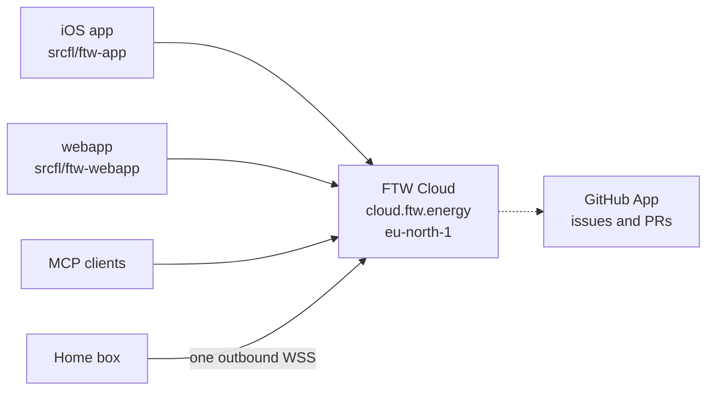

# ADR 0010: FTW Cloud is the single remote entry

- Status: proposed. Nothing here has shipped.
- Date: 2026-10-15
- Decided by: Fredrik on 15 October 2026. The target in [Decision](#decision)
  is his. Questions [(a)](#a-where-the-relay-code-goes),
  [(b)](#b-how-the-cloud-admits-a-command-session),
  [(c)](#c-what-stands-in-for-a-passkey-on-an-agent-command)
  and the [webapp questions](#webapp) are open.
- Revisits: [ADR 0008](0008-ftw-cloud.md), which keeps commands off FTW Cloud,
  and [ADR 0006](0006-app-uplink.md), which makes the relay the only remote
  command path. [ADR 0009](0009-watch-exchange.md) rides that relay and moves
  with it.
- Pair, when this is accepted: `srcfl/ftw-cloud`, `srcfl/ftw-app` and
  `srcfl/ftw-webapp`. The wire change is a paired pull request, as ADR 0008
  requires.

## Context

The box dials two hosts.

- **Stockholm, for the readable copy.** `wss://cloud.ftw.energy/v1/box`,
  `ftwcloudd` on one `t4g.small` in eu-north-1. Core's uplink is
  [`go/internal/cloudlink`](../../go/internal/cloudlink) (#1595). The grant
  defaults off. The service reads what the owner enabled and never dispatches.
  Its routes are `/v1/box`, `/v1/app`, `/v1/app/once`, `/v1/now`, `/source`
  and `/healthz`. It has no accounts, no OAuth and no WebAuthn. Process logs
  stay on the host. Statistics (ADR 0008, C8) are not built.
- **Frankfurt, for commands.** `wss://relay.ftw.energy`, the Node relay in
  [`srcfl/ftw-webapp` `relay/`](https://github.com/srcfl/ftw-webapp/tree/main/relay),
  on its own EC2 in eu-central-1 (`i-0e8fec73834292798`). It forwards opaque
  frames, holds no keys, and keeps no routed traffic. The box's endpoint is
  `appuplink.Endpoint`. A watch's exchange is a second socket to the same host.

The iPhone app is [`srcfl/ftw-app`](https://github.com/srcfl/ftw-app), a
separate codebase from the webapp. Its passkey lives in `Passkey.kt`: the
challenge is local random bytes, the relying-party id is `app.ftw.energy`,
and the box is not a relying party ([ADR 0006](0006-app-uplink.md)). The
webapp is [`srcfl/ftw-webapp`](https://github.com/srcfl/ftw-webapp). Its
pages are Cloudflare static assets (`wrangler.jsonc`); the Noise session
goes to the relay. Escrow is a third host, `escrow.ftw.energy`, also
eu-central-1, and deliberately not the relay's machine.

Roles on the box are `owner`, `viewer` and `watch`
([`contract/registry.yaml`](../../contract/registry.yaml)). The box signs
the device list. The cloud learns devices only from that list.

## Decision

**The box keeps one outbound connection, to FTW Cloud in Stockholm. That
connection carries the readable copy and the command frames. The iOS app,
the webapp, the box and the MCP connector all use this entry. The Frankfurt
relay is retired after they have moved.**

1. **Two clients, one door.** `srcfl/ftw-app` and `srcfl/ftw-webapp` stay
   separate products. The webapp stays up, and it is not the center. Both
   use `cloud.ftw.energy`. An owner approves an agent in the iOS app,
   because that is where the passkey runs.

2. **One socket from the box.** The #1595 uplink carries the signed
   readable classes and the command frames. The box stops dialing
   `relay.ftw.energy`. The connection stays outbound. Nothing listens for
   the cloud to dial in.

3. **A command frame is Noise between the client and the box.** The cloud
   forwards those bytes unchanged and has no key that opens an iOS or
   webapp session. This revises ADR 0008: the service carries commands, it
   cannot read them, and it does not choose an action. Readable classes
   stay signed and readable. A forwarded frame is not a new cleartext
   instruction. `challenge`, `hello_ok`, `watch`, `resync` and `purged`
   stay the only downlink messages that mean something in the clear.

4. **This entry is the door for reads, writes, remote commands, logs,
   statistics and the MCP connector.**

5. **The box issues an agent.** The owner approves it in the iOS app with
   the passkey. The box adds a device-list row with role `agent` and issues
   a delegated session key: scoped, expiring, and revocable from the app.
   The cloud checks that key on every MCP call. The box checks the command
   again. The passkey stays in the app.

6. **The first agent reads live data and sends control.** Statistics and
   logs come later, on this same entry.

7. **One MCP server, many homes.** A client such as Grok Bot, ChatGPT or
   Claude uses OAuth 2.1. The access token maps to one home's delegated
   key. A token for one home is useless against another.

8. **GitHub is a separate App.** It can open an issue or a pull request
   after redaction. It cannot merge.



Frankfurt (`relay.ftw.energy`) is absent on purpose. Escrow
(`escrow.ftw.energy`) stays its own host unless the [webapp
questions](#webapp) say otherwise.

## Data flow

```mermaid
sequenceDiagram
  participant Box
  participant Cloud as FTW Cloud
  participant Client as iOS app, webapp, or agent
  Box->>Cloud: one uplink
  Note over Box,Cloud: signed live, plan, prices, health
  Client->>Cloud: read
  Cloud-->>Client: the box's bytes
  Client->>Cloud: Noise command frame
  Note over Cloud: forward unchanged
  Cloud->>Box: same bytes
  Box->>Cloud: Noise reply
  Cloud->>Client: same bytes
```

The box is still the record and the authority. A command carries an expiry
and preconditions. Core revalidates it against fresh state. Planner output
still never reaches hardware. Stale site-meter data still stops dispatch.
The cloud's routing check is not that decision.

An agent command is Noise between the connector and the box. The connector
holds that agent's delegated key, so it can read what it sends. It holds no
key for a phone or a browser. Those frames stay opaque in the forwarder.

The uplink today closes on a lane 0 frame, and the relay's command lane is
lane 0, padded. The fold needs a carrier for the opaque bytes that does not
turn them into a readable class. That carrier is part of [(b)](#b-how-the-cloud-admits-a-command-session).

## Auth flow

```mermaid
sequenceDiagram
  participant Owner as Owner, iOS app
  participant Box
  participant Client as MCP client
  participant Cloud as FTW Cloud
  Owner->>Owner: passkey, RP app.ftw.energy
  Owner->>Box: approve an agent
  Box->>Box: role agent, delegated key
  Box->>Cloud: signed device list
  Client->>Cloud: OAuth 2.1, PKCE
  Cloud->>Owner: consent in the iOS app
  Cloud->>Client: token for this home only
  Client->>Cloud: MCP call
  Cloud->>Cloud: token, scope, expiry, roster
  Cloud->>Box: Noise as that agent
  Box->>Box: scope, expiry, fresh state
```

There is still no cloud account, password or user directory. The OAuth
subject is the agent device id the box assigned. The passkey cannot run
inside an MCP client, so the consent step hands off to the iOS app. How
that handoff works is open under [(c)](#c-what-stands-in-for-a-passkey-on-an-agent-command).

Revoking the row in the app removes it from the signed device list. The
next call fails, at the cloud and at the box. A key past its expiry fails
at the box even if the cloud is wrong.

Working scope set, until (c) picks it: `ftw.live.read`, `ftw.plan.read`,
`ftw.health.read`, `ftw.dispatch.write`. Not on the first cut:
`ftw.mode.write`, `ftw.members.write`, `ftw.assets.read`, and
`api.passthrough`. Control stays on `cmd`.

## Logs and statistics

**Logs.** New scope `ftw.logs.read`, opt-in, redacted, short retention. The
agent reads its own home through this entry: a redacted cloud excerpt and,
when the owner allows it, a redacted box excerpt the box sends up. Names,
addresses, serials, tokens and the rendezvous secret stay out. The length
of retention is open. Today the cloud's lines stay on the host and the
box's lines stay on the box. ADR 0008's rule stands beside this: no staff
read path.

**Statistics.** The plug-in is a later MCP read of this home's own history,
sent by the box under a scope the grant and the agent role both carry
(`ftw.history.read`, and the in-memory tiles ADR 0008 already describes).
The cross-home store (C8, `statsId`, consent, off by default) is not an
agent API and is not mixed into a home's token.

## GitHub

A GitHub App, separate from the MCP OAuth client. It may open issues and
pull requests. It has no merge permission and it never merges by itself.
The body is redacted first: no household identifiers, no raw logs. The
first post is a high-risk action under [(c)](#c-what-stands-in-for-a-passkey-on-an-agent-command).

## Open questions

### (a) Where the relay code goes

The forwarder has to sit on the process that holds the box's one socket. A
second public host would mean a second dial, or a hop. `ftwcloudd` ends TLS
itself; a TLS proxy in front breaks the exporter binding, so the relay's
Caddy does not move in front of the uplink.

- **Port to Go in `srcfl/ftw-cloud`.** One process, one host, one
  certificate. `relay.ftw.energy` is a certificate name and a DNS alias
  until old clients are gone, then the name and `i-0e8fec73834292798` go.
  The relay's dead-man switch and `POST /fleet` have to be placed in that
  cutover. Cloud already sends `box.unreachable`.
- **Keep the Node relay as a loopback container on the Stockholm host.**
  Two codebases, one host. `ftwcloudd` still owns 443 and hands command
  bytes to the container. The box does not dial the container.

The blindness tests in `relay/` have to keep failing when a watt, an op
name or a device name appears in a log or in memory.

### (b) How the cloud admits a command session

The property is decided: opaque Noise, forwarded unchanged, no key for an
iOS or webapp session, nothing routed written to disk. The mechanism is
open.

- Admit a client only when the signed device list contains its key. The
  relay's capability was knowledge of the hourly handle. The cloud already
  has a stable home id, so the handle does not have to be the capability.
- Tell two sessions apart without reading them. The relay broadcasts
  because it cannot. An outer session id, still inside the home, is the
  alternative. A watch must not take a phone's slot (ADR 0009: four
  streams, eight exchange sessions).
- Rate-limit a client so it cannot fill the one socket. The numbers are
  open.
- Carry the bytes in a form the uplink will accept. Lane 0 is refused
  today.

Terminating Noise for an iOS or webapp session at the cloud would let the
cloud read the command. That shape is out.

One socket means the service that can read live data also sees command
sizes and timing for that home. ADR 0008 already says an operator who runs
both paths can correlate them. Here the correlation is the connection
itself. The privacy notice has to say so.

### (c) What stands in for a passkey on an agent command

The passkey still gates creating, widening and revoking the agent. An MCP
client cannot show that prompt. Working substitute:

- an allowlist of `cmd` ops per scope, taken from the registry
- a rate cap and a magnitude cap on what an op may ask
- a push to the iOS app, approved there, for a high-risk action: site
  mode, planner preferences, a durable goal, a GitHub post, and anything
  outside the allowlist

Open: which ops are high-risk, the numbers, and whether the OAuth handoff
is a device code or a universal link into the app.

### Webapp

The webapp uses this same Stockholm path. It is not wrapped into the iOS
app, and it is not switched off.

- **What moves.** `relay/` is the Frankfurt EC2 and goes with it. `escrow/`
  is another eu-central-1 instance, `escrow.ftw.energy`, on purpose not
  that machine; retiring the relay does not move the sealed recovery
  store. The pages are Cloudflare static assets, not an EC2. Open: escrow
  stays, or is re-hosted, or is proxied via Stockholm. Open: the static
  host stays on Cloudflare.
- **The browser session.** The page opens a WebSocket to
  `cloud.ftw.energy` and runs the Noise session it runs to the relay
  today. Open: the webapp also opens the iPhone's readable-copy session
  (`/v1/app`), or it keeps its cache and uses only the command tunnel.
- **Origin and passkey.** The handshake is cross-origin and must allow the
  webapp's origin only. The relying-party id is `app.ftw.energy`. A page
  on `cloud.ftw.energy` cannot use that id, so those passkeys would stop
  verifying. Widening the id to `ftw.energy` would let any origin under
  the domain derive the PRF key, which the webapp architecture refuses.
  Working choice: pages stay on `app.ftw.energy`; the cloud socket allows
  that origin.
- **Order and DNS.** The working sequence is the [phase table](#phases).
  `relay.ftw.energy` aliases to Stockholm only while an old client still
  dials it, and only with a certificate that names it. Escrow's name does
  not follow that alias. Frankfurt is switched off last.

## Phases

| Step | Content | Proof |
|---|---|---|
| 0 | This ADR | Accepted |
| 1 | Opaque command frames on the uplink; Frankfurt still serves old boxes | A box with the relay firewalled accepts a command |
| 2 | The iOS app sends commands to Stockholm | A phone, and the box is not dialing Frankfurt |
| 3 | The webapp sends commands to Stockholm | A browser session from the allowed origin |
| 4 | Role `agent`, delegated key, approve and revoke in the iOS app | Revoke fails the next call |
| 5 | MCP server: OAuth 2.1, live read and control, one home per token | A second home's token is refused |
| 6 | Alias `relay.ftw.energy`, move the watch exchange, then switch Frankfurt off | No production box dials eu-central-1 |
| 7 | Opt-in logs, `ftw.logs.read` | A redacted excerpt expires |
| 8 | This home's statistics on the MCP read | The aggregate store has no agent API |
| 9 | GitHub App | A redacted issue, and no way to merge |

Steps 1 and 3 wait on (a), (b) and the webapp questions. Steps 7–9 stand
on their own after 5.

## What stays

- Local control, the LAN page, planning and safety need no Sourceful
  service. After Frankfurt is gone, a home with the grant off has no
  remote command path. That is a further step away from
  [#1323](https://github.com/srcfl/ftw/issues/1323) than ADR 0008, which
  still had the webapp on the relay.
- The passkey stays in the client. The box stores no WebAuthn credential.
- `ftwcloudd` still imports only `go/protocol` from this repository. A
  connector in that repo speaks the app protocol as a client and does not
  link control code.
- Escrow's claim is unchanged unless the webapp question moves the host.
- Lane 0's padding rule is unchanged for as long as a relay path exists.
  The cloud connection stays unpadded, as ADR 0008 decided, so command
  sizes are visible on it.

## Consequences

- ADR 0008's "not a control path" becomes "forwards ciphertext, never
  reads it, never dispatches". Homes that leave the grant off keep a
  readable copy of nothing, and, once the alias is removed, no remote
  commands either.
- Whoever runs the host can read memory, as ADR 0008 already says, and
  can see command timing beside the readable copy.
- A wire change is paired pull requests in this repository and
  `srcfl/ftw-cloud`, plus the iOS app and the webapp on the steps that
  move them.
