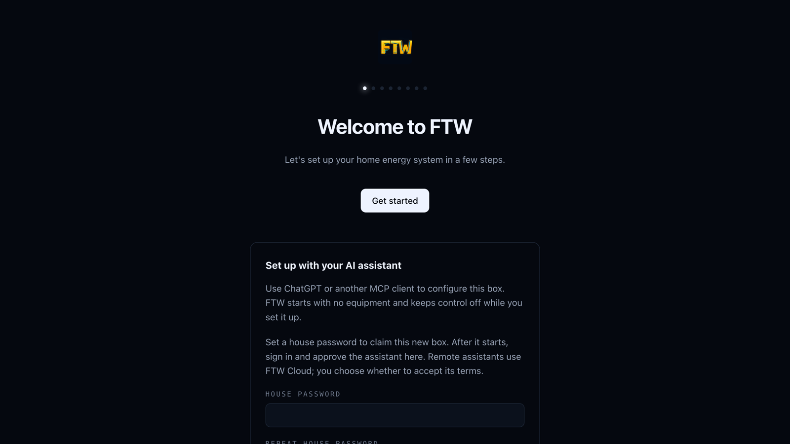
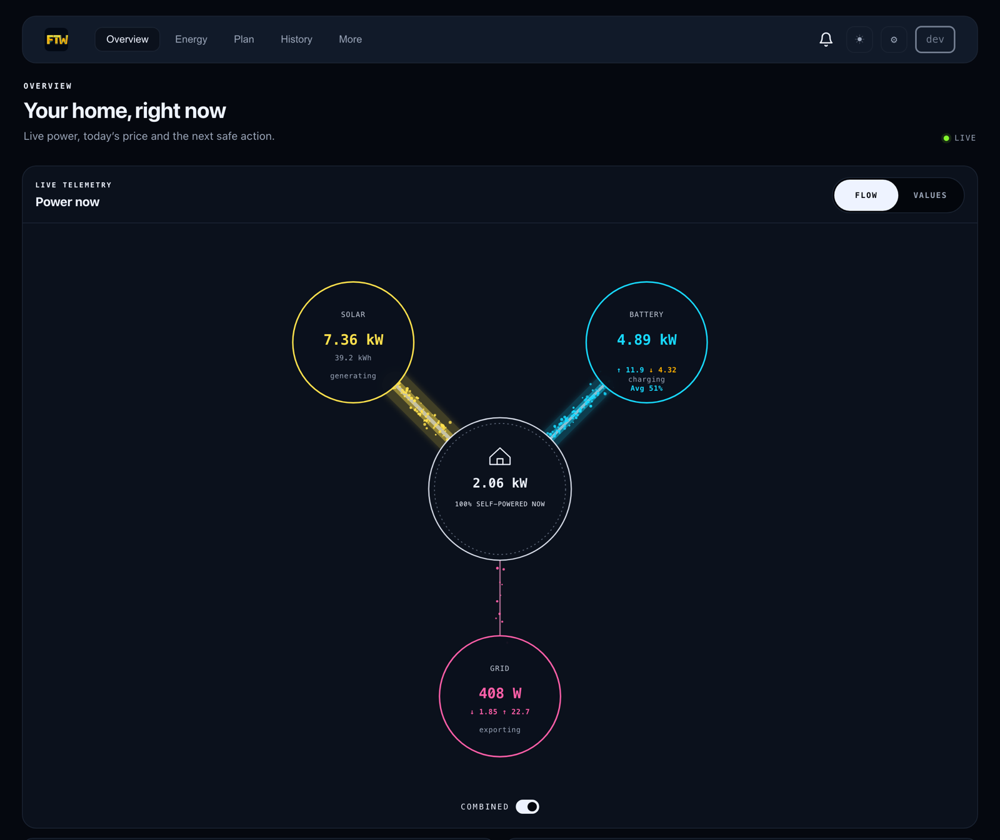

# Install FTW

For a first install. FTW is in public beta, so expect frequent updates.
[Svenska](setup-guide/install-sv.md)

> **Already running FTW?** To update, see
> [Update a native box](native-beta.md#update-a-native-box). If you run 2.x,
> 3.x or the old Raspberry Pi image, follow the
> [switch guide](native-beta.md#coming-from-an-older-ftw) instead. Do not run
> the commands on this page on a card or computer that holds an older FTW.

## Before you start

- Find your inverter, battery, meter and charger in the
  [device catalog](https://srcfl.github.io/device-drivers/). A charger that
  speaks OCPP needs no driver; see [OCPP chargers](ocpp.md).
- Put the FTW computer on the same home network as the equipment.
- FTW controls the battery and charger you add. Keep the equipment's own app
  at hand so you can take control back.
- Only one FTW may control a home.

## Choose one

| You have | Use |
|---|---|
| Home Assistant OS, for example a Home Assistant Green | [Home Assistant](#home-assistant) |
| A Raspberry Pi 4 or 5, or a 64-bit Debian or Ubuntu computer | [Raspberry Pi or Linux](#raspberry-pi-or-linux) |
| Docker on Linux that you manage yourself | [Docker](native-beta.md#docker) |

These are alternatives. Do not run one after another.

## Home Assistant

FTW runs as an app inside Home Assistant OS (amd64 or aarch64). Home Assistant
Container and Core have no apps; use a Raspberry Pi or Linux computer instead.
The app is a beta in its first pilot.

[](https://my.home-assistant.io/redirect/supervisor_add_addon_repository/?repository_url=https%3A%2F%2Fgithub.com%2Fsrcfl%2Fhome-assistant-addons)

1. Add the repository with the button. Or do it by hand: **Settings → Apps →
   Install app → ⋮ → Repositories**, paste
   `https://github.com/srcfl/home-assistant-addons` and choose **Add**.
2. Open **FTW (0.x beta)** in the app store and choose **Install**. Home
   Assistant builds the app on your device. The first build can take several
   minutes.
3. Turn on **Start on boot** and **Watchdog**, then choose **Start**.
4. Choose **Open web UI** and go on to [Set up your home](#set-up-your-home).

Updates, backup and troubleshooting are in
[FTW on Home Assistant](home-assistant-app.md).

## Raspberry Pi or Linux

You need a Raspberry Pi 4 or 5 with Raspberry Pi OS Lite 64-bit, or a 64-bit
Debian or Ubuntu computer, with port 8080 free. Never set up a Pi? The
[Pi guide](setup-guide/en.md) shows each step with pictures, from the memory
card to the first login.

**1. Copy the version name.** Open
[Releases](https://github.com/srcfl/ftw/releases) and copy the name of the
newest release. It starts with `v0.` and ends with `-beta.` and a number.

**2. Paste the block.** Log in to the computer over SSH. Put the version name
in place of `v0.X.Y-beta.N`, then paste the whole block, including `(` and
`)`:

```bash
(
  set -eu
  tag=v0.X.Y-beta.N
  if [[ ! "$tag" =~ ^v0\.([0-9]+)\.[0-9]+(-beta\.[0-9]+)?$ ]] || (( 10#${BASH_REMATCH[1]} < 131 )); then
    echo "STOP: copy an exact published new 0.x tag from Releases." >&2
    exit 1
  fi
  installer=$(mktemp)
  trap 'rm -f "$installer"' EXIT
  curl -fSL "https://raw.githubusercontent.com/srcfl/ftw/${tag}/scripts/install.sh" -o "$installer"
  bash "$installer" --fresh-host --tag "$tag"
)
```

The installer checks the download, creates an `ftw` user and starts the `ftw`
service. If it reports an error, stop there. Do not try another install
method: look up the message in the
[error table](native-beta.md#if-you-already-got-an-error) or ask in
[Discord](https://discord.gg/UK2ygPBu8N).

**3. Open the setup page.** In a browser on the same network, open
`http://<host>:8080/setup`. `<host>` is the computer's address, for example
`http://ftw.local:8080/setup` if you named it `ftw`.

## Set up your home



Choose **Get started**. The wizard asks for the basics of your home, looks for
devices on the network and helps you pick and set up each one. Check the
summary and save.

Give the FTW computer a fixed address in your router (a DHCP reservation), so
your devices keep finding it.

After setup you land on the dashboard. This one shows simulated devices:



## Next

- **Phone:** get the [iPhone beta](https://testflight.apple.com/join/E4Japad7)
  and [pair it with your box](pairing.md), or try the
  [webapp](https://app.ftw.energy). Both reach the box through an encrypted
  session; losing that link does not stop local control.
- **AI assistant:** [connect Claude, ChatGPT or another assistant](https://ftw.energy/#ai).
- **Updates:** Home Assistant offers them under **Settings → Updates**. On a
  Pi or Linux computer, see
  [Update a native box](native-beta.md#update-a-native-box).
- **Backup:** see [Full backup and safe restore](backup-and-restore.md).
- **Help:** ask in [Discord](https://discord.gg/UK2ygPBu8N), or open an
  [issue](https://github.com/srcfl/ftw/issues) that names your version.
