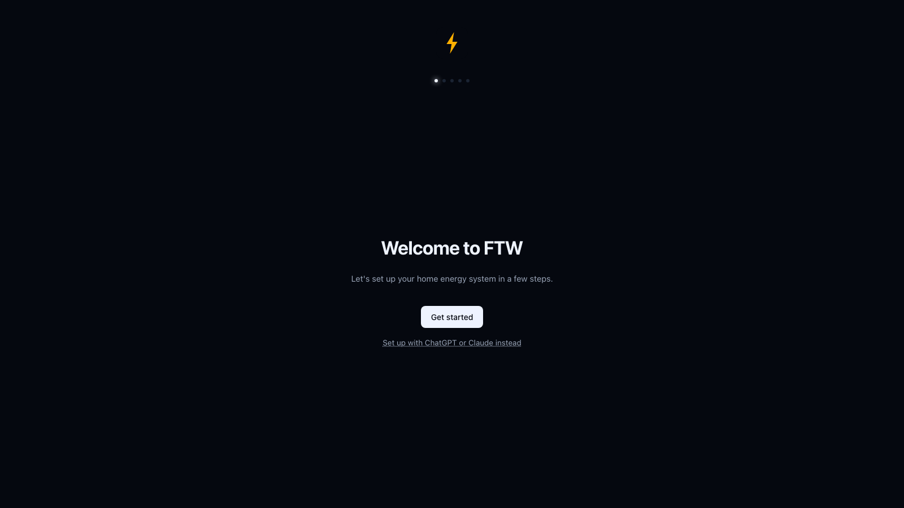
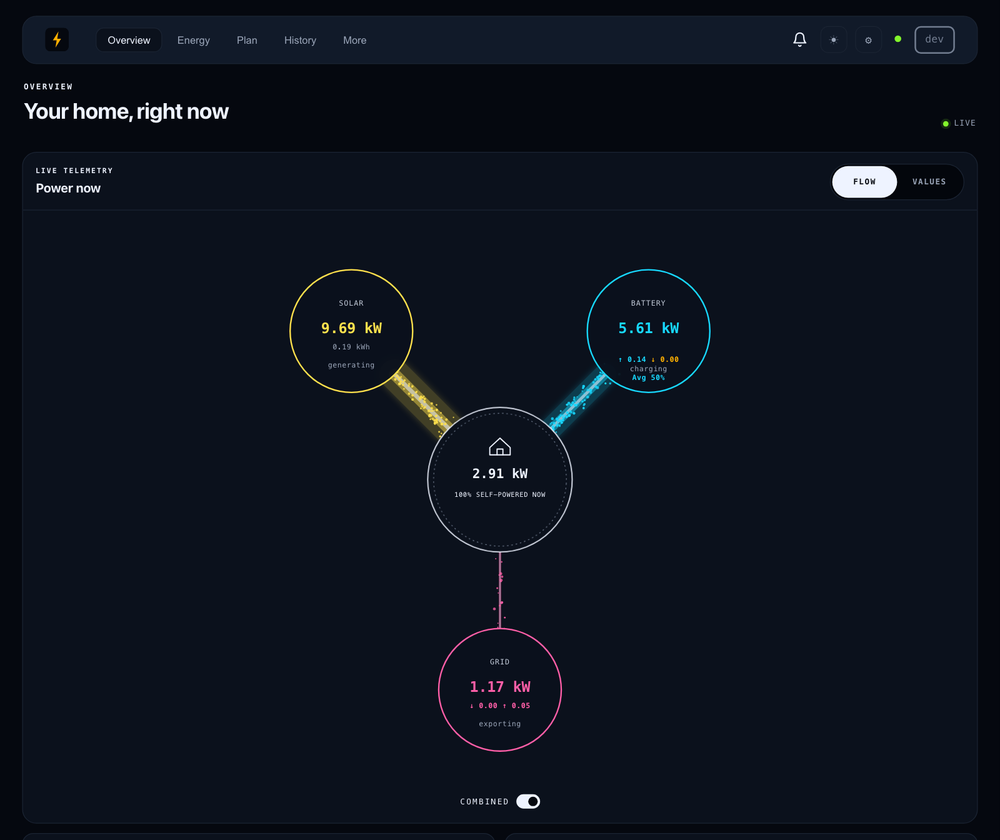

# Install FTW

For a first install. [Svenska](setup-guide/install-sv.md)

Have you run FTW before, here or on another computer? Read
[Have you run FTW before?](before.md) first. Only one FTW may control a home.

## What you need

- A computer that stays on: Home Assistant OS, or any 64-bit Linux computer,
  such as a Raspberry Pi 3 or newer, a mini PC or an old laptop.
- Supported equipment. Find your inverter, battery, meter and charger in the
  [device catalog](https://srcfl.github.io/device-drivers/). A charger that
  speaks OCPP needs no driver; see [OCPP chargers](ocpp.md).
- The FTW computer on the same home network as the equipment.
- The equipment's own app at hand. FTW controls the battery and charger you
  add; that app lets you take control back.

## Home Assistant

FTW runs as an app inside Home Assistant OS (amd64 or aarch64), for example on
a Home Assistant Green, and opens there behind Home Assistant's login. Home
Assistant Container and Core have no apps; use a
[Linux computer](#a-linux-computer) instead.

[](https://my.home-assistant.io/redirect/supervisor_add_addon_repository/?repository_url=https%3A%2F%2Fgithub.com%2Fsrcfl%2Fhome-assistant-addons)

1. Add the repository with the button. Or do it by hand: **Settings → Apps →
   Install app → ⋮ → Repositories**, paste
   `https://github.com/srcfl/home-assistant-addons` and choose **Add**.
2. Open **FTW (beta)** in the app store (its version starts with `0.`) and
   choose **Install**. Home Assistant builds the app on your device. The first
   build can take several minutes.
3. Turn on **Watchdog**, then choose **Start**. **Start on boot** is on
   already.
4. Choose **Open Web UI**. FTW opens inside Home Assistant. Go on to
   [Set up your home](#set-up-your-home).

Updates, backup and troubleshooting are in
[FTW on Home Assistant](home-assistant-app.md).

## A Linux computer

You need a 64-bit Linux computer that starts with systemd, with port 8080
free: Raspberry Pi OS Lite (64-bit) on a Raspberry Pi 3 or newer, or Debian or
Ubuntu on a mini PC or an old laptop. Never set up a Pi? The
[Pi guide](setup-guide/en.md) shows each step with pictures, from the memory
card to this line.

The installer needs about 250 MB of free space and these programs: `curl`,
`tar`, `gzip`, `sha256sum`, `grep`, `awk`, `mktemp` and, unless you install
as root, `sudo`. Raspberry Pi OS, Debian and Ubuntu come with them. If one is
missing, the installer names it and the command that adds it.

Log in to the computer, over SSH or at its own keyboard, and run:

```bash
curl -fsSL https://ftw.energy/install.sh | bash -s -- --fresh-host
```

The installer takes the newest stable release, or the newest beta while there
is no stable, and says which. It checks the download, creates an `ftw` user
and starts the `ftw` service. If sudo asks for a password, type your own. At
the end it prints the addresses to open, for example:

```text
  http://192.168.1.23:8080/setup
  http://ftw.local:8080/setup
```

Open one of them in a browser on the same network.

If it stops with an error, stop there. Do not try another install method: look
up the message in the [error table](native-beta.md#if-you-already-got-an-error)
or ask in [Discord](https://discord.gg/UK2ygPBu8N). If the install was cut
short, the installer tells you to run the same line with `--resume`.

To test betas, add `--beta` at the end of the line. To install one exact
release, add `--tag` and its name from
[Releases](https://github.com/srcfl/ftw/releases). Run Docker yourself? Use
[Docker](native-beta.md#docker) instead.

## Set up your home



Choose **Get started**. The setup guide asks for:

- **Your home:** the country, the price zone and the main fuse from your grid
  contract, for example 16, 20 or 25 A.
- **Your devices:** it looks for them on the network. Pick each one and add it.
- **A house password:** other devices on your Wi-Fi need it to change
  settings. Live numbers stay visible without it. In Home Assistant, its login
  does this job, so the guide skips this step.

Check the summary and choose **Start FTW**. The dashboard opens. This one
shows simulated devices:



Give the FTW computer a fixed address in your router (a DHCP reservation), so
your devices and the app keep finding it.

## Next

- **Phone:** get [FTW Energy for iPhone](https://apps.apple.com/app/ftw-energy/id6822024949)
  and [pair it with your box](pairing.md). Android is coming. The
  [webapp](https://app.ftw.energy) works in any browser.
- **AI assistant:** [connect Claude, ChatGPT or another assistant](https://ftw.energy/#ai).
- **Home Assistant entities:** FTW publishes its values over
  [MQTT](ha-integration.md).
- **Updates:** Home Assistant offers them under **Settings → Updates**. On a
  Linux computer, open **More → Version → Update FTW**, or run `ftw update`.
  See [Update a native box](native-beta.md#update-a-native-box).
- **Backup:** see [Full backup and safe restore](backup-and-restore.md).
- **Help:** ask in [Discord](https://discord.gg/UK2ygPBu8N), or open an
  [issue](https://github.com/srcfl/ftw/issues) that names your version.
