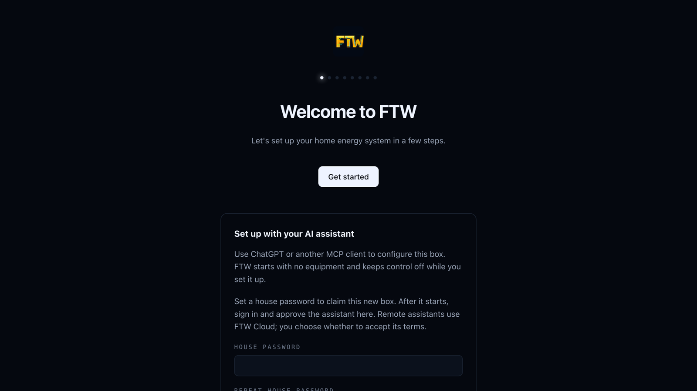
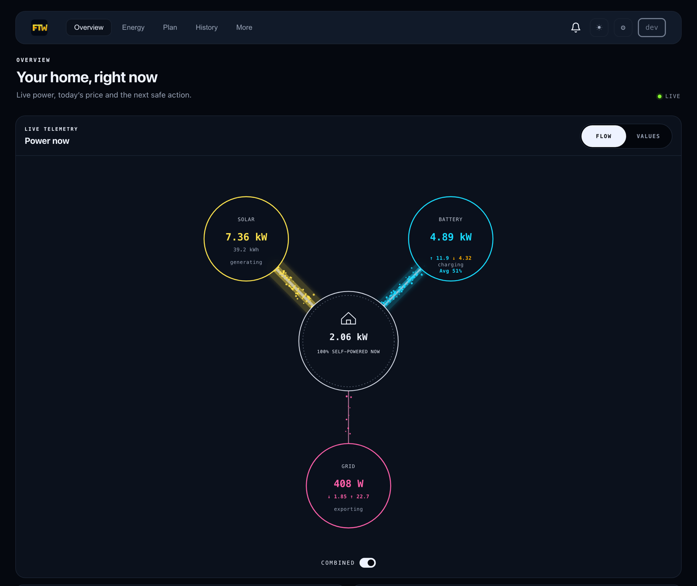

# Installera FTW

För en första installation. FTW är i öppen beta, så räkna med täta
uppdateringar. [English](../install.md)

> **Kör du redan FTW?** För att uppdatera, se
> [Uppdatera när du redan kör nya FTW](update-sv.md#uppdatera-när-du-redan-kör-nya-ftw).
> Kör du 2.x, 3.x eller den gamla Raspberry Pi-avbilden: följ
> [bytesguiden](update-sv.md) i stället. Kör inte kommandona på den här sidan
> på ett kort eller en dator som har en äldre FTW.

## Innan du börjar

- Leta upp din växelriktare, ditt batteri, din elmätare och din laddbox i
  [enhetskatalogen](https://srcfl.github.io/device-drivers/). En laddbox som
  talar OCPP behöver ingen drivrutin; se [OCPP-laddare](../ocpp.md).
- Sätt FTW-datorn på samma hemnätverk som utrustningen.
- FTW styr det batteri och den laddbox du lägger till. Ha utrustningens egen
  app till hands, så att du kan ta tillbaka styrningen.
- Bara en FTW får styra ett hem.

## Välj en väg

| Du har | Använd |
|---|---|
| Home Assistant OS, till exempel en Home Assistant Green | [Home Assistant](#home-assistant) |
| En Raspberry Pi 4 eller 5, eller en 64-bitars dator med Debian eller Ubuntu | [Raspberry Pi eller Linux](#raspberry-pi-eller-linux) |
| Docker på Linux som du sköter själv | [Docker](../native-beta.md#docker) |

Vägarna är alternativ. Kör inte en efter en annan.

## Home Assistant

FTW körs som en app inne i Home Assistant OS (amd64 eller aarch64). Home
Assistant Container och Core har inga appar; använd en Raspberry Pi eller en
Linux-dator i stället. Appen är en beta i sin första pilot.

[](https://my.home-assistant.io/redirect/supervisor_add_addon_repository/?repository_url=https%3A%2F%2Fgithub.com%2Fsrcfl%2Fhome-assistant-addons)

1. Lägg till arkivet med knappen. Eller för hand: **Inställningar → Appar →
   Installera app → ⋮ → Git-arkiv**, klistra in
   `https://github.com/srcfl/home-assistant-addons` och välj **Lägg till**.
2. Öppna **FTW (0.x beta)** i appbutiken och välj **Installera**. Home
   Assistant bygger appen på din enhet. Första bygget kan ta flera minuter.
3. Slå på **Starta vid uppstart** och **Watchdog**, och välj sedan **Starta**.
4. Välj **Öppna webbgränssnittet** och gå vidare till
   [Ställ in ditt hem](#ställ-in-ditt-hem).

Uppdateringar, backup och felsökning finns i
[FTW på Home Assistant](home-assistant-sv.md).

## Raspberry Pi eller Linux

Du behöver en Raspberry Pi 4 eller 5 med Raspberry Pi OS Lite 64-bit, eller en
64-bitars dator med Debian eller Ubuntu, med port 8080 ledig. Har du aldrig
ställt in en Pi? [Pi-guiden](sv.md) visar varje steg med bilder, från
minneskortet till första inloggningen.

**1. Kopiera versionsnamnet.** Öppna
[Releases](https://github.com/srcfl/ftw/releases) och kopiera namnet på den
nyaste versionen. Det börjar med `v0.` och slutar med `-beta.` och en siffra.

**2. Klistra in blocket.** Logga in på datorn över SSH. Sätt versionsnamnet i
stället för `v0.X.Y-beta.N` och klistra sedan in hela blocket, med `(` och
`)`:

```bash
(
  set -eu
  tag=v0.X.Y-beta.N
  if [[ ! "$tag" =~ ^v0\.([0-9]+)\.[0-9]+(-beta\.[0-9]+)?$ ]] || (( 10#${BASH_REMATCH[1]} < 131 )); then
    echo "STOP: copy an exact published new 0.x tag from Releases." >&2
    exit 1
  fi
  installer=$(mktemp)
  trap 'rm -f "$installer"' EXIT
  curl -fSL "https://raw.githubusercontent.com/srcfl/ftw/${tag}/scripts/install.sh" -o "$installer"
  bash "$installer" --fresh-host --tag "$tag"
)
```

Installern kontrollerar nedladdningen, skapar användaren `ftw` och startar
tjänsten `ftw`. Om den visar ett fel: stanna där. Prova inte ett annat sätt
att installera. Leta upp felet i
[feltabellen](update-sv.md#om-du-redan-har-fått-ett-fel) eller fråga i
[Discord](https://discord.gg/25xcBzQaux).

**3. Öppna installationssidan.** Öppna `http://<värd>:8080/setup` i en
webbläsare på samma nätverk. `<värd>` är datorns adress, till exempel
`http://ftw.local:8080/setup` om du gav den namnet `ftw`.

## Ställ in ditt hem



Välj **Get started**. Guiden frågar efter grunderna om ditt hem, letar efter
enheter på nätverket och hjälper dig att välja och ställa in var och en.
Kontrollera sammanfattningen och spara.

Ge FTW-datorn en fast adress i routern (en DHCP-reservation), så att dina
enheter fortsätter att hitta den.

Efter inställningen kommer du till instrumentpanelen. Den här visar simulerade
enheter:



## Sedan

- **Telefon:** hämta [iPhone-betan](https://testflight.apple.com/join/E4Japad7)
  och [parkoppla den med din box](../pairing.md), eller prova
  [webappen](https://app.ftw.energy). Båda når boxen genom en krypterad
  session; tappas den länken fortsätter den lokala styrningen.
- **AI-assistent:** [koppla Claude, ChatGPT eller en annan assistent](https://ftw.energy/#ai).
- **Uppdateringar:** Home Assistant visar dem under **Inställningar →
  Uppdateringar**. På en Pi eller Linux-dator, se
  [Uppdatera när du redan kör nya FTW](update-sv.md#uppdatera-när-du-redan-kör-nya-ftw).
- **Backup:** se [Full backup och säker återställning](../backup-and-restore.md).
- **Hjälp:** fråga i [Discord](https://discord.gg/25xcBzQaux), eller öppna ett
  [ärende](https://github.com/srcfl/ftw/issues) som nämner din version.
