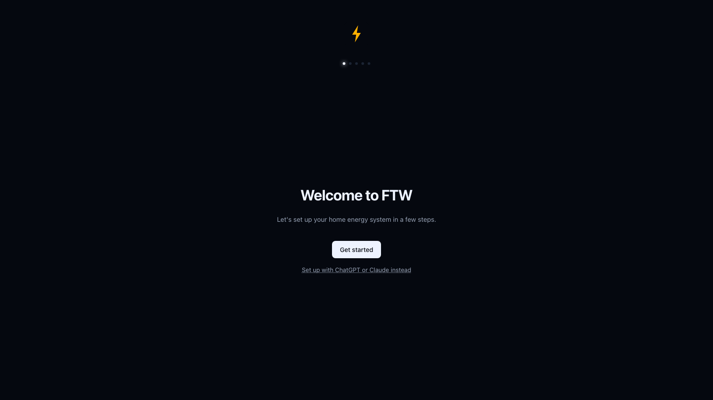
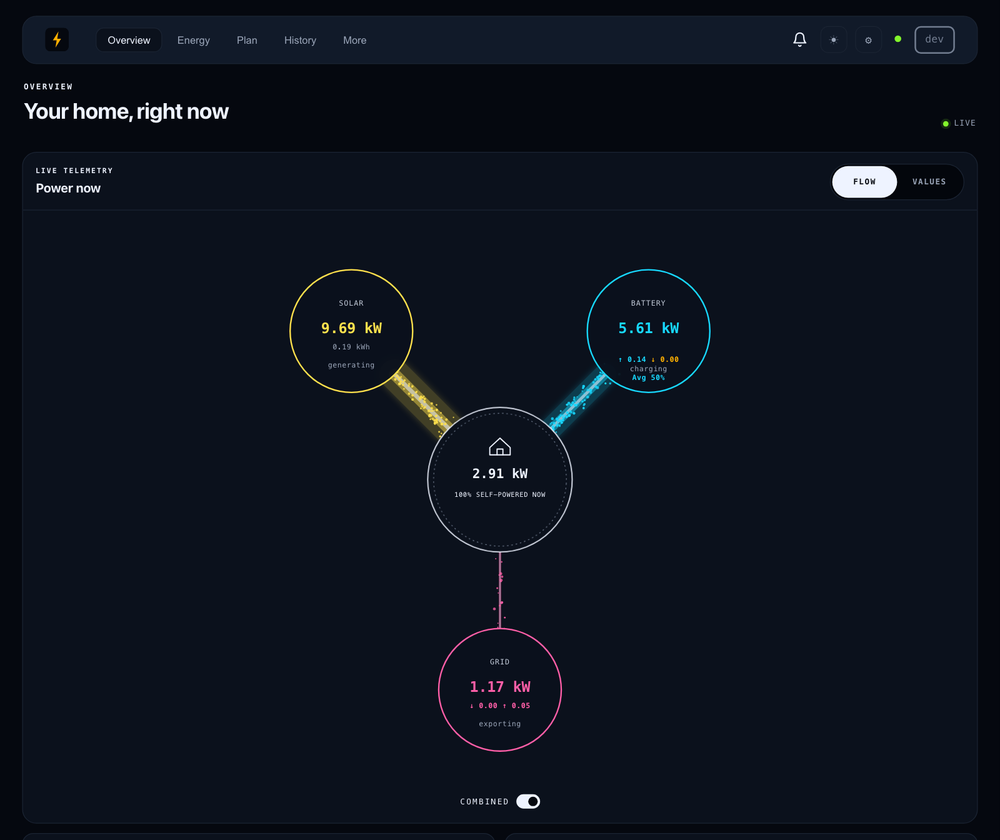

# Installera FTW

För en första installation. [English](../install.md)

Har du kört FTW förut, här eller på en annan dator? Läs
[Byt till nya FTW](update-sv.md) först. Bara en FTW får styra ett hem.

## Det här behöver du

- En dator som alltid är på: Home Assistant OS, eller en 64-bitars
  Linux-dator, till exempel en Raspberry Pi 3 eller nyare, en minidator eller
  en gammal laptop.
- Utrustning som FTW stöder. Leta upp din växelriktare, ditt batteri, din
  elmätare och din laddbox i
  [enhetskatalogen](https://srcfl.github.io/device-drivers/). En laddbox som
  talar OCPP behöver ingen drivrutin; se [OCPP-laddare](../ocpp.md).
- FTW-datorn på samma hemnätverk som utrustningen.
- Utrustningens egen app till hands. FTW styr det batteri och den laddbox du
  lägger till; med den appen tar du tillbaka styrningen.

## Home Assistant

FTW körs som en app inne i Home Assistant OS (amd64 eller aarch64), till
exempel på en Home Assistant Green, och öppnas där bakom Home Assistants
inloggning. Home Assistant Container och Core har inga appar; använd en
[Linux-dator](#en-linux-dator) i stället.

[](https://my.home-assistant.io/redirect/supervisor_add_addon_repository/?repository_url=https%3A%2F%2Fgithub.com%2Fsrcfl%2Fhome-assistant-addons)

1. Lägg till arkivet med knappen. Eller för hand: **Inställningar → Appar →
   Installera app → ⋮ → Git-arkiv**, klistra in
   `https://github.com/srcfl/home-assistant-addons` och välj **Lägg till**.
2. Öppna **FTW (beta)** i appbutiken (versionen börjar med `0.`) och välj
   **Installera**. Home Assistant laddar ned FTW:s färdiga avbild.
3. Slå på **Watchdog** och välj sedan **Starta**. **Starta vid uppstart** är
   redan på.
4. Välj **Öppna webbgränssnittet**. FTW öppnas inne i Home Assistant. Gå
   vidare till [Ställ in ditt hem](#ställ-in-ditt-hem).

Uppdateringar, backup och felsökning finns i
[FTW på Home Assistant](home-assistant-sv.md).

## En Linux-dator

Du behöver en 64-bitars Linux-dator som startar med systemd, med port 8080
ledig: Raspberry Pi OS Lite (64-bit) på en Raspberry Pi 3 eller nyare, eller
Debian eller Ubuntu på en minidator eller en gammal laptop. Har du aldrig
ställt in en Pi? [Pi-guiden](sv.md) visar varje steg med bilder, från
minneskortet till den här raden.

Installern behöver ungefär 250 MB ledigt utrymme och de här programmen:
`curl`, `tar`, `gzip`, `sha256sum`, `grep`, `awk`, `mktemp` och, om du inte
installerar som root, `sudo`. Raspberry Pi OS, Debian och Ubuntu har dem. Saknas
ett av dem säger installern vilket och vilket kommando som lägger till det.

Logga in på datorn, över SSH eller vid dess eget tangentbord, och kör:

```bash
curl -fsSL https://ftw.energy/install.sh | bash -s -- --fresh-host
```

Installern tar den nyaste stabila versionen, eller den nyaste betan så länge
ingen stabil finns, och säger vilken. Den kontrollerar nedladdningen, skapar
användaren `ftw` och startar tjänsten `ftw`. Frågar sudo efter ett lösenord,
skriv ditt eget. Sist skriver den ut adresserna att öppna, till exempel:

```text
  http://192.168.1.23:8080/setup
  http://ftw.local:8080/setup
```

Öppna en av dem i en webbläsare på samma nätverk.

Kör du raden igen på en box som den redan har installerat ändrar den
ingenting. Den säger att FTW redan är installerat och skriver ut adresserna.
Den avslutar med 0 när FTW körs eller startar och med 1 när det inte gör det,
och säger då hur du startar det. `--tag` och `--beta` gör ingenting på en sådan
box: kör `ftw update` för en nyare version.

Om den stannar med ett fel: stanna där. Prova inte ett annat sätt att
installera. Leta upp felet i
[feltabellen](update-sv.md#om-du-redan-har-fått-ett-fel) eller fråga i
[Discord](https://discord.gg/25xcBzQaux). Avbröts installationen säger
installern att du ska köra samma rad med `--resume`.

Vill du prova betor, lägg till `--beta` sist på raden. För en exakt version,
lägg till `--tag` och dess namn från
[Releases](https://github.com/srcfl/ftw/releases). Kör du Docker själv? Använd
[Docker](../native-beta.md#docker) i stället.

## Ställ in ditt hem



Välj **Get started**. Guiden frågar efter:

- **Ditt hem:** land, elområde och huvudsäkringen i ditt elnätsavtal, till
  exempel 16, 20 eller 25 A.
- **Dina enheter:** den letar efter dem på nätverket. Välj var och en och lägg
  till den.
- **Ett huslösenord:** andra enheter på ditt Wi-Fi behöver det för att ändra
  inställningar. Värdena just nu syns utan det. I Home Assistant gör dess
  inloggning det jobbet, så guiden hoppar över steget.

Kontrollera sammanfattningen och välj **Start FTW**. Översikten öppnas. Den här
visar simulerade enheter:



Ge FTW-datorn en fast adress i routern (en DHCP-reservation), så att dina
enheter och appen fortsätter att hitta den.

## Sedan

- **Telefon:** hämta [FTW Energy för iPhone](https://apps.apple.com/app/ftw-energy/id6822024949)
  och [parkoppla den med din box](../pairing.md). Android kommer. Med
  [webappen](https://app.ftw.energy) går det i vilken webbläsare som helst.
- **AI-assistent:** [koppla Claude, ChatGPT eller en annan assistent](https://ftw.energy/#ai).
- **Home Assistant-entiteter:** FTW publicerar sina värden över
  [MQTT](../ha-integration.md).
- **Uppdateringar:** Home Assistant visar dem under **Inställningar →
  Uppdateringar**. På en Linux-dator, öppna **More → Version → Update FTW**,
  eller kör `ftw update`. Se
  [Uppdatera när du redan kör nya FTW](update-sv.md#uppdatera-när-du-redan-kör-nya-ftw).
- **Backup:** se [Full backup och säker återställning](../backup-and-restore.md).
- **Hjälp:** fråga i [Discord](https://discord.gg/25xcBzQaux), eller öppna ett
  [ärende](https://github.com/srcfl/ftw/issues) som nämner din version.
